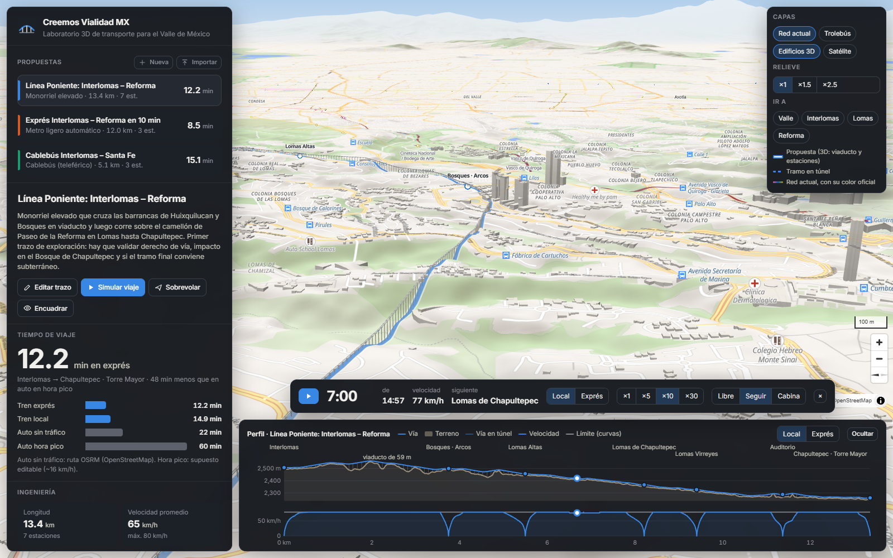
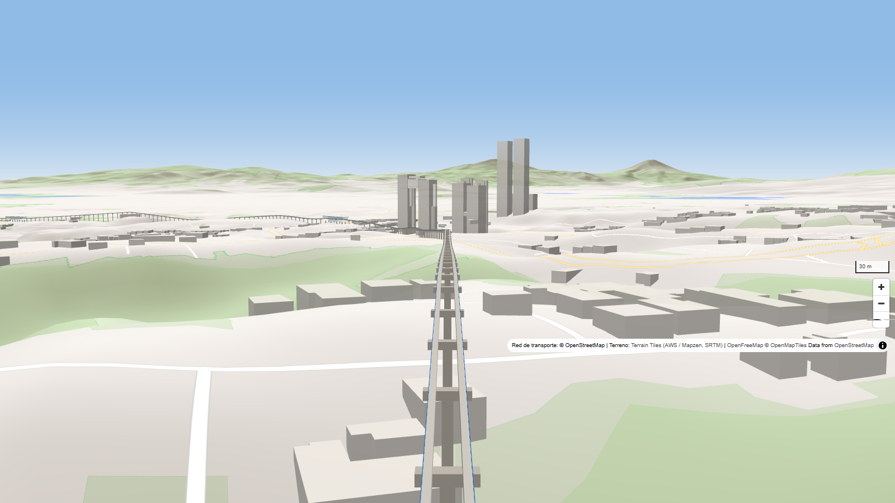

# Creemos Vialidad MX

**Traza un tren sobre el relieve real del Valle de México y descubre en segundos si se puede:** tiempo de viaje, pendientes, curvas, túneles, la altura de cada viaducto y cuánto costaría.



## La pregunta que lo empezó

¿Un tren de **Interlomas a Reforma en 10 minutos**? El motor responde:

| Idea | Tiempo | Costo aprox. (USD) |
|---|---|---|
| Monorriel elevado, 7 estaciones | 15 min · 12 en exprés | 0.8–1.6 mil millones |
| Metro automático en túnel bajo Lomas | **8.5 min** | 1.6–3.4 mil millones |
| Auto en hora pico (hoy) | ~60 min | — |

Se puede. Cuesta el doble. Y ahora se discute con números.

## Pruébalo

```bash
npm install
npm run dev
```

Elige una propuesta, dale **Simular viaje** y cambia la cámara a **Cabina**.



## Cómo funciona

- **Mapa 3D real:** relieve SRTM, edificios y la red actual (Metro, Metrobús, Suburbano, El Insurgente, Cablebús…).
- **Motor de ingeniería en TypeScript:** curvas de vía reales, perfil optimizado entre viaducto y túnel, simulación de marcha y avisos en lenguaje claro.
- **Cada propuesta es un JSON** en [`src/data/propuestas/`](src/data/propuestas/): se versiona, se comparte y se puede diseñar con IA.

Guía completa (formato de datos, supuestos, comandos): [docs/GUIA.md](docs/GUIA.md)

---

<sub>Cifras de orden de magnitud para soñar con números, no ingeniería de detalle. Mapa © colaboradores de OpenStreetMap · OpenFreeMap · Terrain Tiles (AWS/Mapzen, SRTM).</sub>
